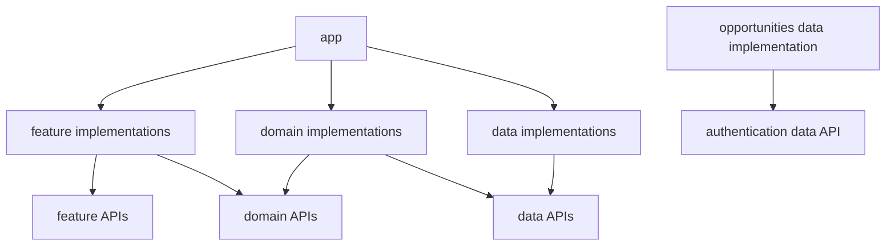

# Architecture and design choices

The app separates screen behavior, use-case contracts, and data access. Its most substantial coordination lives in the ViewModels and opportunity repositories. This guide describes the implementation; the tradeoffs below are an interpretation of its structure, not a record of the original author's intent.

## Module map

[settings.gradle.kts](../settings.gradle.kts) includes **32 modules**. In the table, each brace expands into separate module paths.

| Modules | Count | Responsibility |
|---|---:|---|
| `:app` | 1 | Application/activity, navigation shell, account UI, dependency assembly |
| `:core:{common,designsystem,model,mvi,preferences}` | 5 | Shared utilities, UI, models, MVI infrastructure, and saved device appearance |
| `:{data,domain,feature}:authentication:{auth-api,auth-impl}` | 6 | Repository/session contracts and Supabase adapter; use cases; authentication routes/screens |
| `:{data,domain,feature}:opportunities:{opportunities-api,opportunities-impl}` | 6 | Repository/cache/network; use cases; Discovery/Browse routes/screens |
| `:{data,domain}:workspaces:{workspaces-api,workspaces-impl}` | 4 | Pipeline, Signal analysis, Solution/build contracts, authenticated I/O and document cache |
| `:feature:search:{search-api,search-impl}` | 2 | Search screens/navigation; operation implementation remains scaffolded |
| `:feature:builds:{builds-api,builds-impl}` | 2 | Build generation, approval, tasks, plan, documents and export |
| `:feature:projects:{projects-api,projects-impl}` | 2 | Analyze project list, analysis panels, overrides and conversations |
| `:feature:settings:{settings-api,settings-impl}` | 2 | Saved appearance, version and app-owned sign-out |
| `:feature:details:{details-api,details-impl}` | 2 | Shared details/evidence/post screens; remaining operation logic is unfinished |

These are selected **Gradle dependency edges**, grouped across authentication/opportunities; they are not runtime call arrows. Core dependencies and repeated app-to-API declarations are omitted.

Feature API modules mainly expose destinations; domain APIs expose use cases; data APIs expose repositories/session access. Implementations generally re-export their own API with Gradle `api(...)`. One notable extra export: [opportunities feature implementation](../feature/opportunities/opportunities-impl/build.gradle.kts) also exposes its domain API. Authentication features use `implementation(...)` for that dependency. Thus the boundaries are useful conventions, not complete dependency isolation.

## Assembly and application flow

[app dependencies](../app/build.gradle.kts) bring implementations into the APK. Hilt constructor injection and module bindings connect use-case contracts to implementations and repository contracts to data adapters. The app also [constructs Supabase](../app/src/main/kotlin/com/example/problemfinder/app/di/SupabaseModule.kt). It is a composition root, but does more than wiring: [ApplicationViewModel](../app/src/main/kotlin/com/example/problemfinder/app/ApplicationViewModel.kt) directly observes the data-layer `AuthSessionProvider`, while using a domain use case for sign-out.

[UseCase](../core/common/src/main/kotlin/com/example/problemfinder/core/common/UseCase.kt) makes operations callable through suspending `invoke(params)`. Current domain implementations mostly delegate to repositories; they do not automatically switch dispatchers, retry, or add transactions. Observation use cases return a `Flow`; request use cases trigger work. For example, Browse observation reads Room, while refresh fetches a first page and replaces that query's cache. Collecting the cache alone does not fetch the network.

## State, effects, and concurrent work

[BaseMVIViewModel](../core/mvi/src/main/kotlin/com/example/problemfinder/core/mvi/BaseMVIViewModel.kt) implements the shared MVI pattern: UI intents enter the ViewModel, `reduce` updates immutable state through a private `MutableStateFlow`, and screens render the exposed `StateFlow`. State describes current content, loading, errors, and pending cards.

Navigation and transient messages use a buffered `Channel`, exposed through `receiveAsFlow`. These effects are queued events for a collector, not durable state or broadcast notifications. They are not guaranteed across process death. [Feature navigation](../feature/opportunities/opportunities-impl/src/main/kotlin/com/example/problemfinder/feature/opportunities/impl/Navigation.kt) collects state with lifecycle awareness and effects inside `LaunchedEffect`; those are different collection lifetimes.

`safeLaunch` runs in `viewModelScope`, rethrows cancellation, and sends other exceptions to `onError`. It does not serialize intents. [BrowseViewModel](../feature/opportunities/opportunities-impl/src/main/kotlin/com/example/problemfinder/feature/opportunities/impl/browse/BrowseViewModel.kt) separately manages observation, refresh, page, and watch jobs. Cancellation plus version counters prevents obsolete completions from updating current UI after query/account changes.

## Cache consistency and failure boundaries

Analyze/Build use a separate version-1 workspace database. Each account/project/versioned document is one validated JSON cache record, preserving atomic document versions rather than joining fields from different generations. Query observation needs account identity, not credentials. Repeated identical cache rows are filtered before decoding; decode work and network/write processing run away from the UI thread. A corrupt derived cache reports a completed failed read so refresh can repair it. It does not become a successful empty workspace.

WorkspaceWorkflows is the domain action boundary for the related analysis/build operations. Its implementation validates intent values and delegates I/O to WorkspaceRepository. Requests serialize per account/project, validate response ownership/identity before cache writes, and cancel stale-account work. UI generations separately reject late request completions. Document drafts retain their original edit version; successful document save and matching draft removal share one Room transaction. Task progress preserves the plan version and requires current approval, while document edits create a new draft version.

[OpportunitiesDatabase](../data/opportunities/opportunities-impl/src/main/kotlin/com/example/problemfinder/data/opportunities/impl/db/OpportunitiesDatabase.kt) stores shared card content keyed by `(userId, clusterId)`. Browse membership/order is keyed by account, category, and sort; Discovery has dashboard metadata and collection memberships. Both join the same cards, so one watch update reaches every cached occurrence. `cacheReady` means the local read finished; `hasSynced` records successful remote data, including an empty result.

[Local writes](../data/opportunities/opportunities-impl/src/main/kotlin/com/example/problemfinder/data/opportunities/impl/local/BrowseLocalDataSource.kt) group content, memberships, and cursor changes in Room transactions. Append checks the expected cursor, preserves existing positions, and updates duplicate card content. Repository account checks discard responses for an account no longer active at the checkpoint. Sign-out changes observation/navigation; it does not delete the account's retained Room cache.

The shared [mutex](../data/opportunities/opportunities-impl/src/main/kotlin/com/example/problemfinder/data/opportunities/impl/util/OpportunitySyncCoordinator.kt) spans requests and writes across Browse, Discovery, and watch mutations. This prevents an older in-flight refresh from overwriting a later watch result, at the cost of queueing unrelated requests. HTTP and Room are **not one atomic transaction**: a successful server mutation can outlive cancellation or a failed local write, requiring a later refresh to reconcile.

[Opportunity error mapping](../data/opportunities/opportunities-impl/src/main/kotlin/com/example/problemfinder/data/opportunities/impl/util/OpportunityOperations.kt) classifies HTTP, transport, and decoding failures; authentication uses its own Supabase error mapper. Cancellation passes through. Failed opportunity refreshes retain prior cached content, while ViewModels expose the request failure separately.

## Tradeoffs to explain

| Observed choice | Benefit and cost; plausible alternative |
|---|---|
| API/implementation pairs and thin use cases | Substitutable contracts, with substantial module/boilerplate overhead; fewer modules suit smaller scope. |
| Shared normalized Room cards | Consistent watch state across screens, with more joins and transaction work; duplicated screen caches simplify reads but require coordinated updates. |
| One synchronization mutex | Straightforward ordering, with reduced concurrency; narrower locks require more careful conflict handling. |
| Server-confirmed watch updates | Avoids optimistic rollback logic, but waits for network confirmation; optimistic state needs reconciliation rules. |
