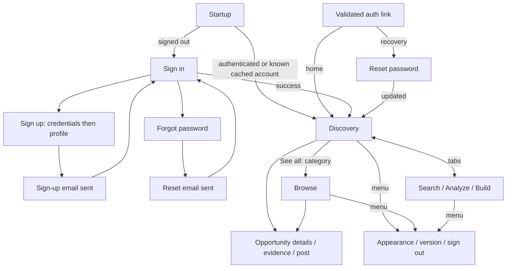

# Navigation and feature behavior

Read this as the implemented screen map, including unfinished destinations. It describes source behavior, not a device-tested walkthrough. [AppNavigation](../app/src/main/kotlin/com/example/problemfinder/app/navigation/AppNavigation.kt) owns one `NavController`; feature navigation functions connect screen intents/effects to host callbacks.

The diagram shows entry paths; stack behavior and sign-out apply across screens as described below.

| Route / screen | Arguments and entry |
| --- | --- |
| `startup` | Initial NavHost destination; progress or account-read retry. |
| `sign_in` | Root for signed-out users; links to registration/recovery. |
| `sign_up` | Two form steps within one route; no navigation argument. |
| `forgot_password` | Email form, opened from sign-in. |
| `sign_up_email_sent` | Registration request succeeded; message and sign-in action. |
| `reset_email_sent` | Recovery-email request succeeded; message and sign-in action. |
| `reset_password` | Opened after successful recovery-link session handling. |
| `discovery_dashboard` | Signed-in home and first tab. |
| `browse_all?category={category}` | Optional string enum name; absent/unrecognized values become `ALL`; initial sort is `NEWEST`. |
| `search`, `projects`, `builds` | Remaining tabs; no arguments. |
| `settings` | Shared app menu; no arguments. |
| `opportunity_details/{clusterId}` | Integer ID from a card; route builder requires a positive value. |

Auth registrations are in [authentication navigation](../feature/authentication/auth-impl/src/main/kotlin/com/example/problemfinder/feature/authentication/impl/Navigation.kt). Browse's [route registration](../feature/opportunities/opportunities-impl/src/main/kotlin/com/example/problemfinder/feature/opportunities/impl/Navigation.kt) passes category through `SavedStateHandle`; later filter changes update ViewModel state, not the URL. Details passes identity only, not an opportunity object.

## Back stack and shared controls

Auth success, password update, email-sent outcomes, explicit return to sign-in, and session redirects use `navigateToRoot`: clear destinations above the graph and open one root with `launchSingleTop`. An already-current target is left alone. Registration and forgot-password are pushed from sign-in. In registration's profile step, [BackHandler](../feature/authentication/auth-impl/src/main/kotlin/com/example/problemfinder/feature/authentication/impl/signup/SignUpScreen.kt) returns to credentials when not loading; this changes form state rather than popping navigation.

Selecting a tab pops back to Discovery and navigates with `launchSingleTop`. There is no per-tab `saveState`/`restoreState` configuration. Browse highlights the Discovery tab and has an app-bar Back action. Settings Close and details Back call `popBackStack()`, returning to the underlying screen. Other system Back behavior uses the normal navigation stack.

[Shared chrome](../app/src/main/kotlin/com/example/problemfinder/app/navigation/ImmensityScaffold.kt) means the top menu and bottom tabs. It appears on Discovery, Browse, Search, Projects, and Builds. Startup/auth hide it; Settings and details provide their own controls. Signing out disables tabs/menu actions and shows progress. Failure produces a snackbar with Retry; successful session sign-out routes to sign-in.

## Session entry and auth links

[Root policy](../app/src/main/kotlin/com/example/problemfinder/app/navigation/AuthNavigationPolicy.kt) distinguishes an unknown identity from a known account. Initialization may show Discovery from persisted identity before network refresh completes. Refresh failure preserves signed-in access for a known account; a completed read without an account requires sign-in. An unreadable identity during refresh failure can return signed-in screens to recoverable Startup. Explicit `NotAuthenticated` overrides cached identity. Authenticated recovery and registration forms are not automatically replaced merely because a session exists.

[The manifest](../app/src/main/AndroidManifest.xml) accepts `com.codingwithjoseph.immensity://auth`. [MainActivity](../app/src/main/kotlin/com/example/problemfinder/app/MainActivity.kt) handles initial and `singleTop` replacement intents: `/reset-password` requests recovery; an empty path or `/` requests home; other paths are ignored. Supabase processes the link first. Only session success queues the destination; failure shows a toast. The navigation effect consumes that pending destination once. These are activity-handled auth callbacks, not registered opportunity deep links.

## Feature states and limits

| Feature | Implemented behavior |
| --- | --- |
| Auth forms | Local validation, loading/duplicate-submit guards, mapped errors. Registration validates credentials, then names; reset requires matching nonblank passwords. Successful requests emit navigation effects. |
| Discovery | Cached featured card/collections appear before refresh. Distinguishes loading, never-synced, confirmed-empty, and errors. Cached cards remain during refresh/failure; repeated entry reuses an active observer. |
| Browse | Category/sort changes replace observation. Cached rows survive refresh errors; no-data screens distinguish unsynced/empty/error. Later composition entry requests refresh. |
| Paging | Requires ready, synced cache and a cursor. Near-bottom scrolling requests pages; duplicate cursors are suppressed. Page errors stay in the footer and require explicit retry. Refresh and paging cannot overlap. |
| Watch/unwatch | Independent card action; duplicate taps disabled by ID. Observed cache supplies the resulting watch value. Errors use snackbars; account changes clear old content/pending work and invalidate stale results. |
| Analyze | Account-scoped project stages, cached analysis, explicit generation with foreground polling, thesis confirmation, problem pin/reject, assumption resolution, grounded conversations and explicit proposal decisions. |
| Build | Eligible project list, cached solution/plan, target/constraint inputs, generation, version-aware approval, verified task progress, document drafts/save/conflict handling and user-selected ZIP export. |
| Settings | Persisted System/Light/Dark appearance, app version and existing app sign-out. The theme also controls category palettes and system-bar contrast. |
| Details / Search | All screens and supporting routes have previews/navigation. Details operation completion and Search mapping/cache/repository/ViewModel work remain intentionally unfinished. |

Analyze workspace children share the parent workspace ViewModel; Build children use the same ownership pattern. Routes carry project/item IDs. Each visible entry owns a polling lease, so generation requests stop polling when all its screens leave the foreground. Navigating into Details or a post still depends on finishing those feature operations.

Build document edits are saved locally by account/project/document while editing. Save creates an immutable draft version, resets approval/task progress, and uses the edit's original version for concurrency checks. A conflict preserves local text. Back offers Save, Keep editing, or Discard. Task progress is a separate mutation: the current plan must be approved; Blocked requires a reason and Done requires user-supplied successful verification checks. Export fetches the ZIP and uses Android's document picker; it needs no broad storage permission.

The deployed backend must provide Pipeline, Signal and Solution APIs and running generation workers. Android task updates additionally require PATCH /pipeline/{id}/solution/case/tasks/{taskId}; the older IDE route accepts a different OAuth credential and is not used by Android. No live AI generation or production mutation is implied by preview/device tests.

For state transitions, start with [DiscoveryViewModel](../feature/opportunities/opportunities-impl/src/main/kotlin/com/example/problemfinder/feature/opportunities/impl/discovery/DiscoveryViewModel.kt) and [BrowseViewModel](../feature/opportunities/opportunities-impl/src/main/kotlin/com/example/problemfinder/feature/opportunities/impl/browse/BrowseViewModel.kt). [Root-policy tests](../app/src/test/kotlin/com/example/problemfinder/app/navigation/AuthNavigationPolicyTest.kt) document session decisions; they do not establish end-to-end delivery of email links or device Back behavior.
