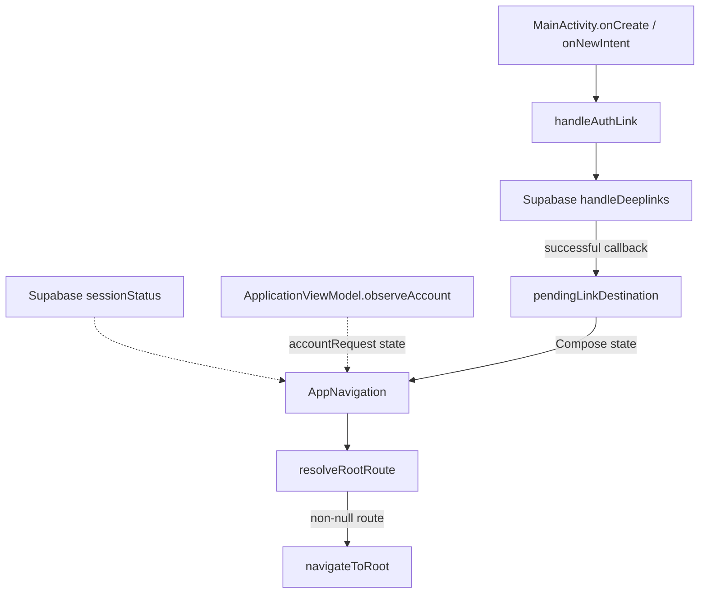
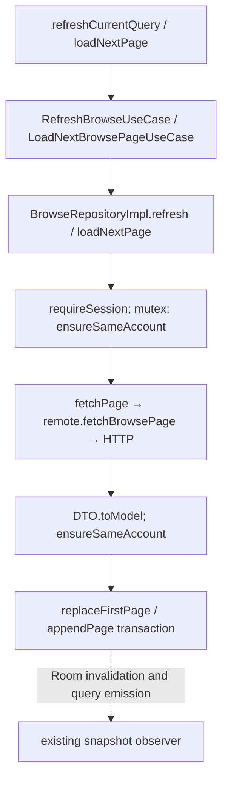

# Runtime flows: who calls whom

Scope: current `main` at `01e3f50` (Discovery dashboard merge). These are selected execution paths through implemented behavior, not an exhaustive framework call graph.

## Reading the paths

Solid arrows below mean calls or explicitly labelled state handoffs; dotted arrows mean asynchronous emissions. A use-case call invokes `UseCase.invoke()` (or `ObservableUseCase.invoke()` for a stream) → the implementation's `execute()` → a repository. These use cases currently delegate rather than adding business rules.

Hilt bindings, such as [BrowseDomainModule](../domain/opportunities/opportunities-impl/src/main/kotlin/com/example/problemfinder/domain/opportunities/impl/di/BrowseDomainModule.kt), select concrete implementations when objects are constructed. A binding method is **not** an extra runtime step on every request.

[Feature navigation](../feature/opportunities/opportunities-impl/src/main/kotlin/com/example/problemfinder/feature/opportunities/impl/Navigation.kt) obtains a destination's ViewModel with `hiltViewModel()`, collects state with `collectAsStateWithLifecycle()`, and collects effects inside `LaunchedEffect(viewModel)`. Rendering emits intents back to `onIntent()`. Leaving the composition cancels its effect collector; ViewModel work follows `viewModelScope`, so a retained back-stack entry can keep its work alive. [BaseMVIViewModel](../core/mvi/src/main/kotlin/com/example/problemfinder/core/mvi/BaseMVIViewModel.kt) exposes latest state through `StateFlow` and queues effects through a buffered channel. Effects are neither broadcast nor persisted across process death.

## Startup and root selection

[MainActivity](../app/src/main/kotlin/com/example/problemfinder/app/MainActivity.kt) accepts the configured auth scheme/host and recognized paths. It makes a link destination pending only after the SDK successfully imports its session; failures show a toast. [ApplicationViewModel.observeAccount()](../app/src/main/kotlin/com/example/problemfinder/app/ApplicationViewModel.kt) separately collects `AuthSessionProvider.observeUserId()`. `Success(null)` means the identity read completed without an account; loading/error are different states.

[resolveRootRoute()](../app/src/main/kotlin/com/example/problemfinder/app/navigation/AuthNavigationPolicy.kt) combines account identity, SDK status, the current route, and an imported link. Links take precedence. Explicit sign-out redirects protected routes to sign-in. Known persisted identity can open Discovery during initialization or refresh failure, allowing cached content. An unreadable identity can return a signed-in route to the startup retry screen. Returning `null` leaves navigation unchanged.

[AppNavigation](../app/src/main/kotlin/com/example/problemfinder/app/navigation/AppNavigation.kt) clears prior destinations when replacing the root, then consumes a pending link. [Policy tests](../app/src/test/kotlin/com/example/problemfinder/app/navigation/AuthNavigationPolicyTest.kt) cover these combinations.

## Authentication commands

[Auth navigation](../feature/authentication/auth-impl/src/main/kotlin/com/example/problemfinder/feature/authentication/impl/Navigation.kt) translates success effects into app callbacks; the ViewModels never call a `NavController`.

| Trigger and direct calls | Result and important branch |
| --- | --- |
| `SignInViewModel.onIntent(Submit)` → `submit()` → `SignInUseCase` → `SupabaseAuthRepository.signIn(email, password)` → SDK `signInWith(Email)` | Returns `AuthUser`; emits `SignedIn`. Blank fields fail locally; email is trimmed, password preserved. |
| `SignUpViewModel.continueToProfile()`; later `submit()` → `SignUpUseCase` → repository `createAccount()` → SDK `signUpWith(Email)` | First step checks email/password locally. Profile submission trims names, sends metadata, clears the password after success, then emits `EmailSent`, not signed-in success. |
| `ForgotPasswordViewModel.submit()` → `ForgotPasswordUseCase` → repository `forgotPassword()` → SDK `resetPasswordForEmail()` | Requests an email containing the recovery redirect; `EmailSent` opens a confirmation message. It does not prove email delivery. |
| Recovery link → activity session import → reset route → `ResetPasswordViewModel.submit()` → `ResetPasswordUseCase` → repository `resetPassword()` → SDK `updateUser()` | Requires nonblank matching passwords locally; service/session failures become form errors. `PasswordUpdated` requests Discovery. |
| Shell sign-out → `ApplicationViewModel.signOut()` → `SignOutUseCase` → repository `signOut()` | SDK session changes drive root selection. Failure emits `SignOutFailed`; the app snackbar's Retry dispatches `SignOutClicked` again. |

The [repository](../data/authentication/auth-impl/src/main/kotlin/com/example/problemfinder/data/authentication/impl/SupabaseAuthRepository.kt) wraps SDK failures as `AuthOperationException`; cancellation propagates. Form `finally` blocks clear loading, and `onError()` records a localized error category. Follow the [auth ViewModels](../feature/authentication/auth-impl/src/main/kotlin/com/example/problemfinder/feature/authentication/impl/) for each branch.

## Browse: observation and requests are separate

```mermaid
flowchart LR
    A["startQuery(category, sort)"] --> B["ObserveBrowseUseCase"]
    B --> C["BrowseRepositoryImpl.observeBrowse"]
    C --> D["BrowseLocalDataSource.observeBrowse"]
    D --> E["BrowseDao.observeBrowse"]
    E -.->|Room rows mapped to BrowseSnapshot| F["acceptSnapshot"]
    F -.->|StateFlow| G["BrowseScreen"]
```

[BrowseViewModel](../feature/opportunities/opportunities-impl/src/main/kotlin/com/example/problemfinder/feature/opportunities/impl/browse/BrowseViewModel.kt) starts observation in `init`, taking category from `SavedStateHandle` (unknown values become `ALL`) and initially using `NEWEST`. The repository's `flatMapLatest` switches Room subscriptions when account identity changes. A known account first receives `cacheReady=false`; a completed local read distinguishes missing cache from a successfully synced empty query through `hasSynced`.

`acceptSnapshot()` publishes cached rows before triggering the initial refresh. The route's first `Entered` avoids duplicating this startup sync; later entries refresh. Changing category/sort cancels old work and increments versions so late results cannot overwrite the new query's state.

The [repository](../data/opportunities/opportunities-impl/src/main/kotlin/com/example/problemfinder/data/opportunities/impl/BrowseRepositoryImpl.kt) fetches `category`, `sort`, and an optional opaque cursor. Refresh replaces **all loaded membership** for that query with the fresh first page. Pagination captures the stored cursor before locking, rechecks it after locking, and rejects a response whose cursor does not advance. `null` ends pagination. Both operations require usable credentials before considering a pagination no-op.

Request completion updates request status; **Room observation supplies the cards**. Refresh/page failures preserve existing rows. Automatic paging stops after a page failure; explicit retry can attempt that cursor again. Account changes invalidate requests and pending watch actions. [BrowseViewModel tests](../feature/opportunities/opportunities-impl/src/test/kotlin/com/example/problemfinder/feature/opportunities/impl/browse/BrowseViewModelTest.kt) exercise cache-first publication, retry gates, cancellation, and late results.

## Discovery and watch changes

[DiscoveryViewModel](../feature/opportunities/opportunities-impl/src/main/kotlin/com/example/problemfinder/feature/opportunities/impl/discovery/DiscoveryViewModel.kt) starts with `Entered` → `startObserving()` → `ObserveDiscoveryUseCase(Unit)` → `DiscoveryRepositoryImpl.observeDiscovery()`. Once the account's local read completes, it calls `reloadDashboard()` → `RefreshDiscoveryUseCase(Unit)` → repository `refresh()`. The same lock/account checks precede `DiscoveryLocalDataSource.replaceDashboard()`. Room then emits the featured card and collections. An already-active observation ignores repeated `Entered`; Reload explicitly refreshes or retries a failed observer.

On either screen, `WatchCluster(id)` → `watchCluster()` → `SetOpportunityWatchedUseCase(Params(userId, id, !isWatched))` → [OpportunityActionsRepositoryImpl.setWatched()](../data/opportunities/opportunities-impl/src/main/kotlin/com/example/problemfinder/data/opportunities/impl/OpportunityActionsRepositoryImpl.kt). Each ViewModel tracks pending IDs and rejects duplicate taps for that card. The repository checks the card's owner, sends POST/DELETE through the remote source, validates returned membership, checks identity again, then calls `OpportunityDao.setWatched()`.

No optimistic membership change occurs. Shared account-scoped opportunity rows update every joined occurrence through Room emissions. The mutex covers network requests **and** cache writes, preventing an earlier refresh from overwriting a successful mutation. Failures produce a `ShowError` effect routed to the app snackbar; stale-account cancellation remains cancellation. [Watch repository tests](../data/opportunities/opportunities-impl/src/androidTest/kotlin/com/example/problemfinder/data/opportunities/impl/OpportunityActionsRepositoryTest.kt) demonstrate shared updates, serialization, and account-switch protection.
